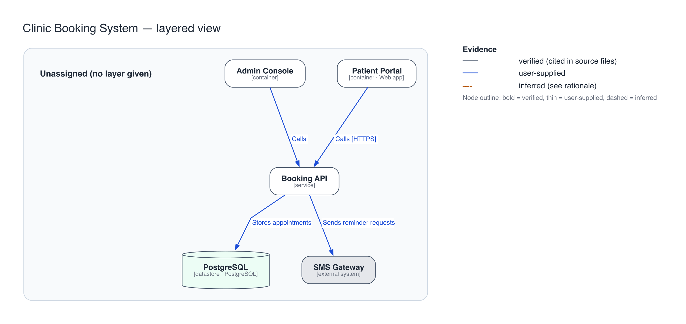

# YuktiForge Skills

**From Intent to Intelligent Capability.**

YuktiForge Skills are installable, reusable capabilities for AI coding agents: each one is a folder with instructions, scripts and evidence rules that an
agent such as Claude Code, GitHub Copilot, OpenAI Codex or Antigravity can discover and follow. They are produced, validated and packaged by the
**YuktiForge** platform, so every skill ships with a manifest, checksums, tests and a record of what was and was not verified.

## Why

Agents give inconsistent answers to the same request, you repeat the same instructions in every project, large codebases are opaque, and a capability that
worked once is hard to reuse or check. A skill packages the *procedure* (and the tools it needs) once, so an agent applies it the same way every time and you
can inspect what it did.

## How it works

1. **Discover**: your agent finds the skill folder in your project.
2. **Install**: unzip the package for your agent at the project root (or use `yuktiforge install` for a preview, overwrite protection, uninstall and rollback).
3. **Invoke**: ask your agent for the task; it loads the skill and runs its bundled script.
4. **Inspect the evidence**: outputs say what is verified, supplied by you, or inferred, and what could not be analysed.
5. **Validate**: each skill has tests and a validation report you can re-run.

This repository is the **skill library** (the packages you install). The **YuktiForge Creator** is the platform that builds and checks skills; you do **not** need it to
install or use a skill from this repository.

## Available skills

<!-- yuktiforge:generated:catalog -->
| Skill | Purpose | Family | Inputs | Outputs | Agents (tested status) | Version | License |
|---|---|---|---|---|---|---|---|
| [`architecture-visualizer`](docs/skill-catalog.md#architecture-visualizer) | Produce architecture diagrams (layered, C4 context, C4 container) from natural-language descriptions, structured YAML/JSON, documentation or source repositories in any la… | architecture | repository; specification | architecture-model: json; diagram-source: graphviz-dot; diagram: svg… | Claude Code (VERIFIED), GitHub Copilot (VERIFIED), OpenAI Codex (VERIFIED), Antigravity (UNVERIFIED) | 0.3.0 | Apache-2.0 |
<!-- /yuktiforge:generated:catalog -->

### Preview skills

Preview skills are published for evaluation. They have not passed every release gate; the reasons are in the catalog.

<!-- yuktiforge:generated:preview -->
| Skill | Purpose | Family | Inputs | Outputs | Agents (tested status) | Version | License |
|---|---|---|---|---|---|---|---|
| [`api-contract-reviewer`](docs/skill-catalog.md#api-contract-reviewer) | This skill reviews an OpenAPI 3 document provided as a JSON file to identify common contract problems. Use this when you need to programmatically check an OpenAPI specifi… | api-quality | specification (openapi-3) | report: json | Claude Code (VERIFIED), GitHub Copilot (VERIFIED), OpenAI Codex (VERIFIED), Antigravity (UNVERIFIED) | 0.1.0 | Apache-2.0 |
| [`repository-intelligence`](docs/skill-catalog.md#repository-intelligence) | Scan a source repository of any language mix without running it: inventory, symbol and integration-boundary index, dependency index and an explicit coverage report, with … | documentation | repository | repository-inventory: json; symbol-index: json; dependency-index: json… | Claude Code (VERIFIED), GitHub Copilot (UNVERIFIED), OpenAI Codex (UNVERIFIED), Antigravity (UNVERIFIED) | 0.1.1 | Apache-2.0 |
| [`documentation-intelligence`](docs/skill-catalog.md#documentation-intelligence) | Orchestrates the whole documentation workflow for an existing codebase: scan, evidence-backed knowledge model, documents (architecture, API, data, behaviour, requirements… | documentation | repository | scan: json; knowledge-model: json; documents: markdown… | Claude Code (VERIFIED), GitHub Copilot (UNVERIFIED), OpenAI Codex (UNVERIFIED), Antigravity (UNVERIFIED) | 0.1.1 | Apache-2.0 |
| [`code-explainer`](docs/skill-catalog.md#code-explainer) | Explains what a module, symbol or whole repository declares and how its parts relate, as an evidence-backed document with file and line citations, written for a chosen au… | documentation | repository | code-explanation: markdown; knowledge-model: json | Claude Code (VERIFIED), GitHub Copilot (UNVERIFIED), OpenAI Codex (UNVERIFIED), Antigravity (UNVERIFIED) | 0.1.1 | Apache-2.0 |
| [`behavior-reconstructor`](docs/skill-catalog.md#behavior-reconstructor) | Reconstructs observable behaviour from code: request paths, workflows, conditions and validations that look like business rules, and candidate use cases, each cited to fi… | documentation | repository | functional-spec: markdown; business-rule-catalog: markdown; use-cases: markdown… | Claude Code (VERIFIED), GitHub Copilot (UNVERIFIED), OpenAI Codex (UNVERIFIED), Antigravity (UNVERIFIED) | 0.1.1 | Apache-2.0 |
| [`requirements-reconstructor`](docs/skill-catalog.md#requirements-reconstructor) | Drafts a business requirements document and a software requirements specification from existing code, as clearly marked reconstructions: candidate requirements with evide… | documentation | repository | brd-draft: markdown; srs-draft: markdown; business-rule-catalog: markdown… | Claude Code (VERIFIED), GitHub Copilot (UNVERIFIED), OpenAI Codex (UNVERIFIED), Antigravity (UNVERIFIED) | 0.1.1 | Apache-2.0 |
| [`architecture-documenter`](docs/skill-catalog.md#architecture-documenter) | Documents a system's architecture from its code: system, solution and technology architecture, a high-level design and a low-level design, with C4 context, container, com… | documentation | repository | system-architecture: markdown; solution-architecture: markdown; technology-architecture: markdown… | Claude Code (VERIFIED), GitHub Copilot (UNVERIFIED), OpenAI Codex (UNVERIFIED), Antigravity (UNVERIFIED) | 0.1.1 | Apache-2.0 |
| [`data-documenter`](docs/skill-catalog.md#data-documenter) | Documents the data a system uses: a data dictionary and database document of tables, columns, keys and queries found in code, SQL and ORM models, plus an entity-relations… | documentation | repository | data-dictionary: markdown; database-doc: markdown; erd: svg | Claude Code (VERIFIED), GitHub Copilot (UNVERIFIED), OpenAI Codex (UNVERIFIED), Antigravity (UNVERIFIED) | 0.1.1 | Apache-2.0 |
| [`api-integration-documenter`](docs/skill-catalog.md#api-integration-documenter) | Documents a system's interfaces: HTTP routes, outbound calls to external services, message topics, OpenAPI contracts reconciled with code, and data flows between them, wi… | documentation | repository | api-catalog: markdown; dataflow: markdown; integration-diagram: svg… | Claude Code (VERIFIED), GitHub Copilot (UNVERIFIED), OpenAI Codex (UNVERIFIED), Antigravity (UNVERIFIED) | 0.1.1 | Apache-2.0 |
| [`operations-documenter`](docs/skill-catalog.md#operations-documenter) | Drafts an operations runbook from a repository: the configuration variables the code reads, container, compose, Terraform and pipeline definitions, runtime dependencies (… | documentation | repository | operations-runbook: markdown; deployment-diagram: svg | Claude Code (VERIFIED), GitHub Copilot (UNVERIFIED), OpenAI Codex (UNVERIFIED), Antigravity (UNVERIFIED) | 0.1.1 | Apache-2.0 |
| [`documentation-quality-auditor`](docs/skill-catalog.md#documentation-quality-auditor) | Measures generated documentation against the evidence: eight pass/fail/not-tested gates (evidence, consistency with the model, invented identifiers, fabricated requiremen… | documentation | repository | evaluation: json; coverage-report: html; change-report: markdown | Claude Code (VERIFIED), GitHub Copilot (UNVERIFIED), OpenAI Codex (UNVERIFIED), Antigravity (UNVERIFIED) | 0.1.1 | Apache-2.0 |
| [`documentation-publisher`](docs/skill-catalog.md#documentation-publisher) | Publishes the documentation as a pack: Markdown sources, an HTML site, a DOCX and an A4 PDF with table of contents and diagrams, then checks links, DOCX structure and ren… | documentation | repository | html-site: html; docx: docx; pdf: pdf… | Claude Code (VERIFIED), GitHub Copilot (UNVERIFIED), OpenAI Codex (UNVERIFIED), Antigravity (UNVERIFIED) | 0.1.1 | Apache-2.0 |
<!-- /yuktiforge:generated:preview -->

The documentation-intelligence family (eleven skills) is in this release as **preview**: each one passed its tests and ran correctly inside Claude Code; the other agents are marked in the compatibility matrix exactly as tested. Nothing here claims more.
Details for every skill: [docs/skill-catalog.md](docs/skill-catalog.md).

## Quick start

Pick your agent; each skill has one zip per agent in `dist/`. The status below is what was **actually tested** (see the [compatibility matrix](docs/compatibility-matrix.md)):

<!-- yuktiforge:generated:agents -->
* **Claude Code** (`.claude/skills/`): `architecture-visualizer` VERIFIED; `api-contract-reviewer` VERIFIED; `repository-intelligence` VERIFIED; `documentation-intelligence` VERIFIED; `code-explainer` VERIFIED; `behavior-reconstructor` VERIFIED; `requirements-reconstructor` VERIFIED; `architecture-documenter` VERIFIED; `data-documenter` VERIFIED; `api-integration-documenter` VERIFIED; `operations-documenter` VERIFIED; `documentation-quality-auditor` VERIFIED; `documentation-publisher` VERIFIED
* **GitHub Copilot** (`.github/skills/`): `architecture-visualizer` VERIFIED; `api-contract-reviewer` VERIFIED; `repository-intelligence` UNVERIFIED; `documentation-intelligence` UNVERIFIED; `code-explainer` UNVERIFIED; `behavior-reconstructor` UNVERIFIED; `requirements-reconstructor` UNVERIFIED; `architecture-documenter` UNVERIFIED; `data-documenter` UNVERIFIED; `api-integration-documenter` UNVERIFIED; `operations-documenter` UNVERIFIED; `documentation-quality-auditor` UNVERIFIED; `documentation-publisher` UNVERIFIED
* **OpenAI Codex** (`.agents/skills/`): `architecture-visualizer` VERIFIED; `api-contract-reviewer` VERIFIED; `repository-intelligence` UNVERIFIED; `documentation-intelligence` UNVERIFIED; `code-explainer` UNVERIFIED; `behavior-reconstructor` UNVERIFIED; `requirements-reconstructor` UNVERIFIED; `architecture-documenter` UNVERIFIED; `data-documenter` UNVERIFIED; `api-integration-documenter` UNVERIFIED; `operations-documenter` UNVERIFIED; `documentation-quality-auditor` UNVERIFIED; `documentation-publisher` UNVERIFIED
* **Antigravity** (`.agents/skills/`): `architecture-visualizer` UNVERIFIED; `api-contract-reviewer` UNVERIFIED; `repository-intelligence` UNVERIFIED; `documentation-intelligence` UNVERIFIED; `code-explainer` UNVERIFIED; `behavior-reconstructor` UNVERIFIED; `requirements-reconstructor` UNVERIFIED; `architecture-documenter` UNVERIFIED; `data-documenter` UNVERIFIED; `api-integration-documenter` UNVERIFIED; `operations-documenter` UNVERIFIED; `documentation-quality-auditor` UNVERIFIED; `documentation-publisher` UNVERIFIED
<!-- /yuktiforge:generated:agents -->

```bash tested
unzip dist/<skill>-<version>-<agent>.zip -d /path/to/your/project
```

Verify the download first (optional):

```bash tested
cd dist && shasum -a 256 -c SHA256SUMS
```

Or let YuktiForge do the install with a preview and a rollback path (requires the `yuktiforge` command):

```bash tested
yuktiforge install dist/<skill>-<version>-<agent>.zip --agent <agent> --project /path/to/your/project          # preview only, writes nothing
yuktiforge install dist/<skill>-<version>-<agent>.zip --agent <agent> --project /path/to/your/project --apply  # install
yuktiforge list --project /path/to/your/project
yuktiforge verify --project /path/to/your/project
```

Step-by-step guides: [Claude Code](docs/install-claude-code.md) · [GitHub Copilot](docs/install-github-copilot.md) · [OpenAI Codex](docs/install-codex.md) · [Antigravity](docs/install-antigravity.md).
Walk-through with real output: [docs/tutorial.md](docs/tutorial.md). Problems: [troubleshooting](docs/tutorial.md#troubleshooting).

## Using the documentation skills, step by step

The eleven documentation skills read a source repository and write evidence-backed documents and diagrams. They never run, build or change the repository.
For a first try install only `documentation-intelligence`: it carries every action; the narrower skills carry subsets and can be installed alone.

1. **Prerequisites (once).** Python 3.12+, and the packages `pydantic` and `PyYAML` at the versions in the skill's `requirements.lock`. The skill can build its own private environment (the only step that downloads anything, and only when you run it): `python3 .claude/skills/<skill>/scripts/bootstrap.py`. Optional tools for diagrams and exports: Graphviz (`dot`), pandoc, Chromium (Playwright) and LibreOffice. A missing tool means that output is reported UNAVAILABLE; nothing fails silently.
2. **Install into the project you want to document** (Claude Code shown; use the other agent's zip for other agents):
   ```bash
   unzip dist/documentation-intelligence-0.1.1-claude-code.zip -d /path/to/your/project
   ```
3. **Check it works.**
   ```bash
   cd /path/to/your/project
   python3 .claude/skills/documentation-intelligence/scripts/yuktiforge_docs.py doctor
   python3 .claude/skills/documentation-intelligence/tests/smoke.py        # expect: smoke: pass
   ```
4. **Use it through your agent**, in plain words. Examples: "Document this repository into docs/ws and tell me which diagrams could not be generated." · "What HTTP routes, tables and external calls does this code have?" · "Audit the generated documentation and report each gate."
5. **Or run it directly.**
   ```bash
   S=.claude/skills/documentation-intelligence/scripts/yuktiforge_docs.py
   python3 $S run --repo . --out docs/ws                                            # scan, model, documents, diagrams
   python3 $S audit --input docs/ws/docs --model docs/ws/model --repo .            # PASS / FAIL / NOT_TESTED per gate
   python3 $S publish --model docs/ws/model --out docs/pack                         # HTML, DOCX, A4 PDF with QA
   python3 $S update --model docs/ws/model --docs docs/ws/docs --repo . --since <git-revision>   # what a change makes stale (add --apply to regenerate)
   ```
6. **Read the output.** Under `--out`: `scan/` (facts), `model/` (knowledge model), `docs/*.md` (documents), `diagrams/` (and `diagrams.json`, which lists the diagrams that could not be generated and why).
   Every statement carries a label: `[VERIFIED]` observed in code with file and line, `[INFERRED]` derived by a stated rule, `[USER_SUPPLIED]` stated by a named person, `[UNKNOWN]` not established, `[NEEDS_STAKEHOLDER_VALIDATION]` needs a business owner.
   Requirements and rules are **reconstructions, never approved**; only a named person can approve (`model approve`), the skill never does. Add what people know with `model assert ... --by "<name>"`; re-runs keep it.
7. **Choose a narrower skill if you only need part of it.**

| You want | Skill |
|---|---|
| Facts about a codebase | `repository-intelligence` |
| One module or class explained | `code-explainer` |
| What the system does, rules, use cases | `behavior-reconstructor` |
| BRD / SRS drafts | `requirements-reconstructor` |
| Architecture, HLD/LLD, diagrams | `architecture-documenter` |
| Tables and an ERD | `data-documenter` |
| APIs, integrations, data flow | `api-integration-documenter` |
| Operations runbook draft | `operations-documenter` |
| Can the documentation be trusted? | `documentation-quality-auditor` |
| HTML / DOCX / PDF to share | `documentation-publisher` |

Generated documents may quote your code, so treat them with the same confidentiality as the repository. Only Claude Code is verified for these skills so far; see the compatibility matrix.

## Examples

<!-- yuktiforge:generated:examples -->
The diagram below was produced by the shipped `architecture-visualizer` skill from its bundled example model (`skills/architecture-visualizer/examples/clinic.model.yaml`). It is **illustrative**: one small fixture, not a claim about your system.



Expected artifacts: `architecture.json`, `diagram.dot`, `diagram.svg`, `diagram.png`, `diagram.pdf`, `preview.html`, `validation.json`. Limitations: layouts can be large, only layered / C4 context / C4 container views exist, and source analysis covers package manifests and Python imports only. No documentation-reconstruction skill is part of this release, so there is no example for one.
<!-- /yuktiforge:generated:examples -->

## Quality and trust

* **Provenance and integrity**: every package has a manifest of SHA-256 hashes and a provenance file naming the source revision; builds are reproducible (same input, same bytes).
* **Evidence, not assertion**: compatibility is shown only from recorded test runs bound to the exact package content; anything not exercised is `UNVERIFIED`.
* **Source-derived vs inferred**: skills mark each element as verified, user-supplied or inferred, and say what they could not analyse.
* **Human review**: a person should review a skill before relying on it; skills generated by the Creator are marked `preview` until someone does.
* **Data stays local**: the shipped skills run locally and need no network; the only downloads are the pinned Python packages you choose to install.

## Architecture and dependencies

Each skill folder is self-contained: it bundles the code and scripts it needs and works without the YuktiForge Creator. Requirements per skill, from its manifest:

<!-- yuktiforge:generated:deps -->
* `architecture-visualizer` 0.3.0: Python 3.12+; `pydantic==2.14.0`, `pyyaml==6.0.3`; external tools: `dot`, `rsvg-convert`.
* `api-contract-reviewer` 0.1.0: Python 3.12+; no third-party packages (Python standard library only); external tools: none.
* `repository-intelligence` 0.1.1: Python 3.12+; `pydantic==2.14.0`, `pyyaml==6.0.3`; external tools: none.
* `documentation-intelligence` 0.1.1: Python 3.12+; `pydantic==2.14.0`, `pyyaml==6.0.3`; external tools: `dot`, `pandoc`, `node`, `git`.
* `code-explainer` 0.1.1: Python 3.12+; `pydantic==2.14.0`, `pyyaml==6.0.3`; external tools: none.
* `behavior-reconstructor` 0.1.1: Python 3.12+; `pydantic==2.14.0`, `pyyaml==6.0.3`; external tools: none.
* `requirements-reconstructor` 0.1.1: Python 3.12+; `pydantic==2.14.0`, `pyyaml==6.0.3`; external tools: none.
* `architecture-documenter` 0.1.1: Python 3.12+; `pydantic==2.14.0`, `pyyaml==6.0.3`; external tools: `dot`, `pandoc`, `node`, `git`.
* `data-documenter` 0.1.1: Python 3.12+; `pydantic==2.14.0`, `pyyaml==6.0.3`; external tools: `dot`, `pandoc`, `node`, `git`.
* `api-integration-documenter` 0.1.1: Python 3.12+; `pydantic==2.14.0`, `pyyaml==6.0.3`; external tools: `dot`, `pandoc`, `node`, `git`.
* `operations-documenter` 0.1.1: Python 3.12+; `pydantic==2.14.0`, `pyyaml==6.0.3`; external tools: `dot`, `pandoc`, `node`, `git`.
* `documentation-quality-auditor` 0.1.1: Python 3.12+; `pydantic==2.14.0`, `pyyaml==6.0.3`; external tools: `dot`, `pandoc`, `node`, `git`.
* `documentation-publisher` 0.1.1: Python 3.12+; `pydantic==2.14.0`, `pyyaml==6.0.3`; external tools: `dot`, `pandoc`, `node`, `git`.
<!-- /yuktiforge:generated:deps -->

## Supported platforms

Tested on macOS (Apple silicon) only. Linux and Windows have not been tested; see the [compatibility matrix](docs/compatibility-matrix.md) and [known limitations](docs/tutorial.md#known-limitations).

## Contributing, releases, license, security

* Contributing and authoring a skill: [CONTRIBUTING.md](CONTRIBUTING.md)
* Release notes: [RELEASE_NOTES.md](RELEASE_NOTES.md) · Release report: [release-report.md](release-report.md)
* License: see [LICENSE](LICENSE) (the status is stated there and in each skill's manifest)
* Security reporting: [SECURITY.md](SECURITY.md)
